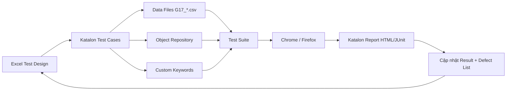
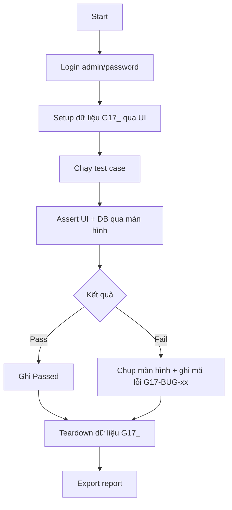

# Kế hoạch Automation Test – Nhóm 17 – Snipe-IT

**Thành viên:** Nguyễn Hữu Thanh – 23130303
**Phạm vi:** 3 chức năng được giao
1. Quản lý tài sản – Assets (sheet `Asset`)
2. Cấp phát và thu hồi tài sản – Checkout/Checkin (sheet `Checkout`)
3. Mẫu tài sản – Asset Models (sheet `Model`)

**Công cụ:** Katalon Studio (theo README nhóm)
**Môi trường:** https://demo.snipeitapp.com – Chrome mới nhất (chạy chính), Firefox (kiểm tra chéo giao diện)
**Tài liệu tham chiếu:** https://snipe-it.readme.io

---

## 1. Mục tiêu và phạm vi tự động hoá

| Mục tiêu | Chỉ số |
|---|---|
| Tự động hoá luồng nghiệp vụ chính của 3 module | ≥ 60% test case ưu tiên P1 |
| Chạy lại được sau mỗi lần demo reset | 100% test suite có bước setup dữ liệu riêng |
| Thời gian chạy toàn bộ suite Asset | ≤ 10 phút |
| Kết quả ánh xạ về Excel | Cột `Result` của sheet chức năng được cập nhật Passed/Failed |

**Trong phạm vi:** thêm/sửa/xóa tài sản, tìm kiếm/lọc, checkout/checkin, thêm/sửa/xóa model, kiểm tra validation và phân quyền cơ bản.

**Ngoài phạm vi:** gửi email, đổi mật khẩu, phân quyền hệ thống, import dữ liệu lớn, kiểm thử tải nhiều người dùng đồng thời. Các mục này ghi `Blocked` hoặc `Skipped` trong Excel.

---

## 2. Kiến trúc automation



**Luồng chạy một suite:**


**Cấu trúc project Katalon:**
```
Group17_SnipeIT_Automation/
├── Profiles/default.glbl                 # URL, tài khoản admin
├── Object Repository/
│   ├── Common/                           # menu, login, toast, modal
│   ├── Asset/                            # list, form, detail
│   ├── Checkout/                         # checkout, checkin, bulk
│   └── Model/                            # list, form
├── Keywords/
│   ├── auth.groovy                       # login/logout
│   ├── data.groovy                       # sinh dữ liệu G17_, setup/teardown
│   └── assert.groovy                     # assert toast, validation, bảng
├── Test Cases/
│   ├── Asset/                            # Asset_01 ... Asset_30
│   ├── Checkout/                         # bổ sung tuần sau
│   └── Model/                            # bổ sung tuần sau
├── Test Suites/
│   ├── TS_Asset_Smoke.ts
│   ├── TS_Asset_Regression.ts
│   └── TS_All.ts
├── Data Files/
│   └── G17_Data.csv
└── Reports/
```

---

## 3. Phạm vi tự động hoá theo module

| Module | Test case tự động | Test case thủ công | Lý do |
|---|---|---|---|
| Asset | Asset-01 → 30 (trừ 04, 20, 27) | 04 responsive, 20 checkout khi tạo, 27 xóa tài sản đang cấp phát | GUI responsive và luồng phụ thuộc dữ liệu người dùng |
| Checkout | Các luồng checkout/checkin User, Asset, Location; validation; bulk | Kiểm tra email, quyền đặc biệt | Demo khóa email, dữ liệu dùng chung |
| Model | Thêm/sửa/xóa, validation, tìm kiếm, Min QTY, Require Serial | Upload ảnh, Fieldset tuỳ chỉnh | Phụ thuộc file và cấu hình demo |

**Ưu tiên P1 (chạy mỗi ngày):** Asset-07, 08, 11, 12, 18, 19, 22, 26, 29; Checkout luồng User; Model thêm/sửa/xóa cơ bản.
**Ưu tiên P2:** validation biên, lọc/sắp xếp, bulk actions.
**Ưu tiên P3:** XSS, phân quyền, hiệu năng.

---

## 4. Chiến lược dữ liệu test

Demo bị reset nhiều lần/ngày và dùng chung, nên **không** phụ thuộc dữ liệu có sẵn.

| Vấn đề | Cách xử lý |
|---|---|
| Dữ liệu bị reset | Mỗi suite chạy `setupData()` trước test, tạo lại Category/Manufacturer/Model/Location/Supplier/User |
| Trùng tên giữa các lần chạy | Hậu tố timestamp: `G17_Model_Asset_<yyyyMMddHHmmss>`; lưu vào biến global |
| Asset Tag tự sinh | Không assert giá trị cố định; đọc Asset Tag sau khi lưu để dùng cho bước sau |
| Không xóa được dữ liệu đang dùng | Teardown theo thứ tự: checkin → xóa asset → xóa model → xóa location/supplier/user |
| Trang bảo trì | Keyword `waitForDemoReady()` retry 3 lần, mỗi lần 60 giây; quá 3 lần đánh `Blocked` |
| Email/mật khẩu bị khóa | Đánh `Blocked`, ghi chú “Không thực hiện được trên demo – bị khóa” |
| Dữ liệu rác của người khác | Luôn lọc/tìm theo tiền tố `G17_` trước khi assert số dòng |

**Bộ dữ liệu tối thiểu:** Category `G17_Laptop`, Manufacturer `G17_Dell`, Model `G17_Model_Asset`, Status `Ready to Deploy`, Location `G17_Kho`, Supplier `G17_Supplier`, User `G17_User`.

---

## 5. Kế hoạch triển khai script

| Bước | Nội dung | Output |
|---|---|---|
| 1 | Record luồng login + tạo asset hợp lệ | Keyword `auth.login`, Test Case Asset-18 |
| 2 | Tách Object Repository theo page, đặt tên `btn_Save`, `txt_AssetTag`, `lbl_Toast` | Bộ locator ổn định |
| 3 | Viết `data.groovy` sinh dữ liệu G17_ và setup/teardown | Chạy lại được sau reset |
| 4 | Automate 10 test case P1 của Asset | TS_Asset_Smoke |
| 5 | Automate validation, sửa, xóa, tìm kiếm | TS_Asset_Regression |
| 6 | Automate Checkout/Checkin cho User, Asset, Location | TS_Checkout |
| 7 | Automate Model và ràng buộc Require Serial/Min QTY | TS_Model |
| 8 | Chạy toàn bộ, đối chiếu Excel, ghi defect | Report + cập nhật Result |

**Quy ước locator:** ưu tiên `id`, sau đó `name`, cuối cùng là XPath theo label/nút; không dùng XPath tuyệt đối theo vị trí. Mọi thao tác chờ bằng `WebUI.waitForElementVisible`, không dùng `Thread.sleep` trừ khi chờ toast.

**Quy ước assert:**
- Thông báo thành công: kiểm tra toast chứa “success” và bản ghi xuất hiện trong danh sách.
- Validation: kiểm tra text lỗi tại đúng trường và bản ghi không được tạo.
- Checkout/Checkin: kiểm tra Status, Checked Out To, Location và một dòng History.
- Khi fail: chụp màn hình, lưu URL, ghi mã `G17-BUG-xx` vào cột `Note` của Excel.

---

## 6. Tiến độ

| Ngày | Việc | Người |
|---|---|---|
| 22/10 | Hoàn thiện TestDesign + 30 test case Asset + kế hoạch automation | Thanh |
| 23/10 | Setup Katalon project, login, setup/teardown dữ liệu | Thanh |
| 24–25/10 | Automate 10 test case P1 Asset, chạy smoke | Thanh |
| 26–27/10 | Automate phần còn lại của Asset, bổ sung test case Checkout/Model | Thanh |
| 28–29/10 | Automate Checkout/Checkin, Model | Thanh |
| 30/10 | Chạy regression, cập nhật Result, viết defect list | Thanh |

---

## 7. Điều kiện vào / ra

**Entry:** demo hoạt động, tài khoản admin đăng nhập được, dữ liệu setup tạo thành công, Katalon mở project không lỗi.

**Exit:** 100% test case P1 chạy xong; ≥ 90% Passed; mọi Failed có mã lỗi và ảnh chụp; report được lưu; cột `Result` trong Excel khớp report.

**Tiêu chí dừng khẩn:** demo bảo trì > 10 phút, hoặc dữ liệu setup fail 3 lần liên tiếp → dừng suite, đánh `Blocked`, báo nhóm.

---

## 8. Rủi ro và giảm thiểu

| Rủi ro | Ảnh hưởng | Giảm thiểu |
|---|---|---|
| Demo reset giữa lúc chạy | Test fail giả | Setup lại trong `Before Test Suite`, dùng dữ liệu riêng G17_ |
| Giao diện đổi do bản mới | Locator gãy | Dùng id/name/label, tách Object Repository, chạy smoke sau mỗi lần đổi |
| Nhiều người dùng chung | Số dòng, tìm kiếm sai | Luôn lọc theo `G17_`, không assert tổng số bản ghi toàn hệ thống |
| Asset Tag tự sinh thay đổi | Assert cứng fail | Đọc giá trị sau khi lưu, truyền qua biến |
| Email bị khóa | Không test được | Ghi `Blocked` + note theo quy ước |
| File Excel bị sửa tay sai công thức | Report sai | Chỉ nhập cột B–H, không sửa cột A và hàng 6 |

---

## 9. Checklist thực hiện

- [x] Chốt 3 module và phạm vi automation
- [x] Chốt công cụ Katalon, Chrome/Firefox
- [x] Chốt bộ dữ liệu G17_ và quy tắc sinh dữ liệu
- [x] Chốt cấu trúc project và quy ước locator/assert
- [x] Chốt tiến độ và điều kiện vào/ra
- [ ] Tạo project Katalon và cấu hình profile
- [ ] Viết keyword login + setup/teardown
- [ ] Automate 10 test case P1 của Asset
- [ ] Chạy smoke đầu tiên và ghi report
- [ ] Automate toàn bộ Asset
- [ ] Bổ sung test case chi tiết và automate Checkout/Checkin
- [ ] Bổ sung test case chi tiết và automate Model
- [ ] Chạy regression cuối, cập nhật Excel và defect list

---

## 10. Liên kết với tài liệu test case

- File Excel: `BaiLam/Group17_23130303_NguyenHuuThanh.xlsx`
- Sheet test case: `Asset` (30 case), `Checkout`, `Model`
- TestDesign: 3 module, 184 tiêu chí
- Mã test case dùng trong report: `[Asset-01]` … `[Asset-30]`; các module còn lại bổ sung theo cùng quy tắc `[Checkout-xx]`, `[Model-xx]`.
