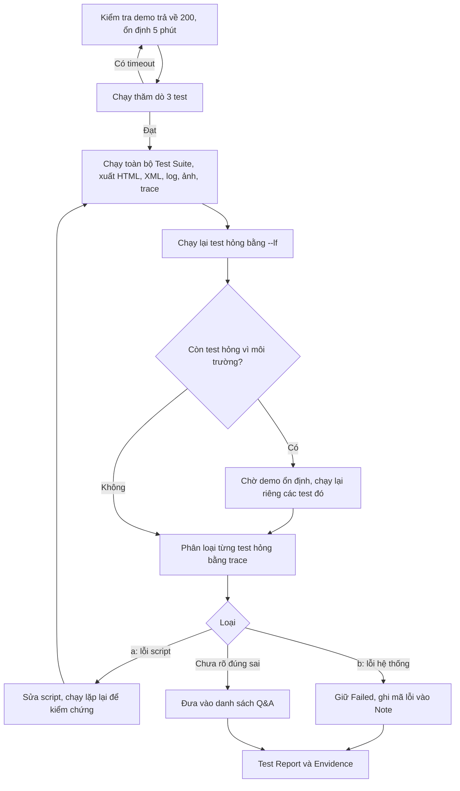
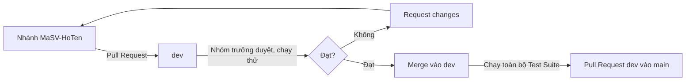

# Kế hoạch Automation Test – Group 17

Kế hoạch tự động hóa kiểm thử hệ thống **Snipe-IT** (https://demo.snipeitapp.com, v8.8.3) cho 15 chức năng của 5 thành viên. Tài liệu ghi lại công cụ, tiêu chí chọn test case, cách tổ chức code, cách xử lý môi trường demo dùng chung và quy trình chạy, phân tích, báo cáo mà nhóm áp dụng ở ASM7 và ASM8.

## 1. Phạm vi

| Nhóm | Thành viên | Chức năng |
|---|---|---|
| A – Tài sản | Nguyễn Hữu Thanh | Asset, Checkout/Checkin, Asset Model |
| B – Phần mềm và cấu hình | Phạm Hữu Đạt | License, Predefined Kit, Custom Field |
| C – Vật tư | Tạ Văn Huy | Accessory, Consumable, Component |
| D – Con người và tổ chức | Bùi Trọng Linh | User, Department, Location |
| E – Danh mục nền | Trịnh Minh Quý | Category, Manufacturer, Supplier |

Mỗi test case trong file Excel của thành viên được đánh giá theo tiêu chí ở mục 3. Test case đạt tiêu chí được viết thành một hàm test; các test case còn lại thực hiện thủ công.

## 2. Công cụ và môi trường

| Thành phần | Lựa chọn | Lý do |
|---|---|---|
| Ngôn ngữ | Python 3.12 | Cú pháp đơn giản, cả nhóm dùng chung |
| Công cụ điều khiển trình duyệt | Playwright 1.64 (Chromium) | Tự chờ phần tử sẵn sàng, ghi trace từng bước, có công cụ ghi thao tác (codegen) |
| Công cụ chạy test | pytest 9.1 + pytest-playwright 0.10 | Fixture cho Pre-condition và dọn dữ liệu, chạy theo file, chức năng hoặc từng test |
| Báo cáo | pytest-html (HTML), JUnit XML | HTML cho người đọc, XML cho công cụ đọc tự động |
| Quản lý mã nguồn | GitHub: `main`, `dev`, nhánh cá nhân | Pull Request và duyệt code trước khi tích hợp |
| Website test | https://demo.snipeitapp.com, tài khoản `admin` / `password` | Demo công khai, dùng chung với nhiều người |

## 3. Tiêu chí chọn test case để tự động hóa

Tự động hóa khi test case thỏa **tất cả** các điều kiện:

- [x] Expected Output **đo được bằng máy**: câu thông báo, dữ liệu được lưu, URL, số dòng trong bảng, thuộc tính của ô nhập
- [x] Dữ liệu cần thiết **tự tạo được** trong test (không phụ thuộc dữ liệu có sẵn hoặc dữ liệu của người khác)
- [x] Chạy lại nhiều lần cho cùng kết quả (không phụ thuộc thời điểm, thứ tự)
- [x] Chức năng không bị demo khóa

Giữ **thủ công** khi:

- [ ] Cần mắt người đánh giá: bố cục, màu sắc, chữ bị tràn, hiển thị trên nhiều trình duyệt (test case giao diện [...-1], [...-2])
- [ ] Phụ thuộc cấu hình máy người test (ví dụ bộ gõ tiếng Việt làm ký tự lọt qua giới hạn độ dài)
- [ ] Demo khóa tính năng (đổi email, mật khẩu, quyền, gửi email, Tag Color)

Ví dụ: phần của Trịnh Minh Quý có 92 test case, tự động hóa 86, thủ công 6 (giao diện), cộng phần kiểm tra bằng mắt của 2 test case trang chi tiết.

## 4. Cấu trúc project

```
Automation Testing Project - Group 17/
├── conftest.py        fixture dùng chung: đăng nhập trước mỗi test, thời gian chờ
├── helpers.py         BASE_URL, tài khoản, unique_name()
├── pytest.ini         thư mục test (tests/), đường dẫn import
├── requirements.txt   thư viện cần cài
├── README.md          cài đặt, cấu hình, cách chạy
└── tests/
    └── test_MaSV_HoTen.py   mỗi thành viên 1 file
```

Quy ước:

- Tên hàm test gắn với mã test case: `test_<module>_<số 2 chữ số>_<mô tả>`, ví dụ `test_category_03_...` là [Category-3].
- Phần dùng chung (`conftest.py`, `helpers.py`, `pytest.ini`, `requirements.txt`) do nhóm trưởng quản lý; thành viên chỉ sửa file của mình.
- Không đặt cài đặt toàn cục trong file test (ví dụ `expect.set_options`), vì sẽ ảnh hưởng toàn bộ Test Suite.

## 5. Quản lý dữ liệu test trên demo dùng chung

- [x] Mọi dữ liệu test có tiền tố `G17_` và mốc thời gian: `G17_Laptop_1793961234567`
- [x] Mỗi test tự tạo dữ liệu và **tự xóa** sau khi chạy, kể cả khi test hỏng (tên được ghi vào danh sách dọn dẹp **trước** khi bấm Save)
- [x] Dữ liệu phụ trợ (Asset Model, Accessory) được dọn trước dữ liệu chính, để không bị chặn xóa
- [x] Không tìm kiếm bằng từ khóa chung `G17`; tìm bằng phần riêng của tên vừa tạo
- [x] Test cần điều kiện (ví dụ "có hơn 20 bản ghi" để phân trang) tự tạo đủ dữ liệu
- [x] Không dùng Purge hoặc Reset dữ liệu của demo

## 6. Quy tắc chờ đúng thời điểm

Phần lớn lỗi của script ở ASM7, ASM8 là chờ sai thời điểm. Quy tắc nhóm thống nhất:

| Tình huống | Cách làm | Không làm |
|---|---|---|
| Kiểm tra kết quả | `expect(...)`: tự chờ đến khi đúng, tối đa 10 giây | `time.sleep()`, `wait_for_timeout()` |
| Mở trang bằng click | `wait_for_url(...)` (chờ trang tải xong) rồi mới thao tác | Thao tác ngay sau click |
| Tìm kiếm trên bảng | Chờ đúng phản hồi API có `search` bằng từ khóa | Chờ cố định rồi đọc bảng (bảng hiện tạm "No matching records found") |
| Sắp xếp bảng | Chờ dữ liệu mới và bảng vẽ xong | Chờ lớp phủ "đang tải" (sắp xếp không hiện lớp phủ) |
| Điền form | Chờ request nền của trang xong (`wait_page_ready`) | Điền ngay khi ô nhập vừa hiện |
| Hộp xác nhận | `expect(...).to_be_visible()` rồi bấm | `is_visible(timeout=...)` (không chờ) |
| Locator | Theo vai trò, tên, `id`; loại trừ phần tử ẩn trùng | `.first` trên tập phần tử rộng |

## 7. Quy trình thực thi



## 8. Phân loại test hỏng

| Loại | Dấu hiệu trong trace | Xử lý |
|---|---|---|
| (a) Lỗi script | Máy chủ trả đúng, script đọc sai chỗ hoặc sai thời điểm | Sửa locator hoặc cách chờ; ghi rõ dòng sửa, trước và sau |
| (b) Lỗi hệ thống | Máy chủ trả sai dữ liệu hoặc sai thông báo so với Expected Output | Giữ test Failed, ghi mã lỗi `#G17-BUG-xx` |
| (c) Môi trường | Demo reset (503), quá tải, file tĩnh treo, mạng chập chờn | Chạy lại khi demo ổn định |

Nguyên tắc:

- Không sửa câu thông báo mong đợi và không nới điều kiện kiểm tra để test Passed.
- Chỉ sửa Expected Output khi có căn cứ (tài liệu hoặc thông báo của chính hệ thống), ghi vào Record of change.
- Test Passed sai nguy hiểm hơn test Failed sai: mọi lần sửa phải được kiểm chứng bằng nhiều lần chạy, và kiểm tra test vẫn Failed khi hệ thống sai.

## 9. Tích hợp và duyệt code



Checklist duyệt Pull Request:

- [ ] Base là `dev`; chỉ chứa file của thành viên, đúng thư mục, đúng tên
- [ ] Mức A (làm hỏng cả bộ): không import thư viện ngoài `requirements.txt`, không có code chạy ngoài hàm, không đặt cài đặt toàn cục, không sửa file chung
- [ ] Mức B (làm sai phần của thành viên): hàm bắt đầu bằng `test_`, không đăng nhập riêng, không đường dẫn tuyệt đối, test không phụ thuộc nhau, không chờ cố định trước khi kiểm tra
- [ ] Mức C (sai quy ước): ghi góp ý, không chặn merge
- [ ] Kéo nhánh về chạy `--collect-only` và vài test của thành viên trước khi merge

## 10. Báo cáo và minh chứng

| Sản phẩm | Nội dung |
|---|---|
| `Test Report - Group 17/` | Báo cáo HTML, XML của từng lần chạy; bản tóm tắt: tổng số, Pass, Fail, Skipped, thời gian, test hỏng kèm nguyên nhân |
| `Envidence - Group17/` | Log từng lần chạy, ảnh chụp test hỏng, trace tiêu biểu |
| File Excel của thành viên | Result, Test date, mã lỗi ở Note, Record of change |

Kết quả được trình bày theo từng lớp (lần chạy chính, chạy lại, kết quả cuối), không gộp nhiều lần chạy thành một con số.

## 11. Rủi ro và biện pháp

| Rủi ro | Biện pháp |
|---|---|
| Demo reset dữ liệu, bảo trì (503) nhiều lần mỗi ngày | Kiểm tra demo và chạy thăm dò trước; chạy lại test lỗi môi trường |
| Demo quá tải, file tĩnh treo | Thời gian tải trang tối đa 30 giây; chạy lúc demo vắng |
| Demo tự đổi giao diện | Gom locator vào hàm dùng chung; ưu tiên locator theo vai trò, tên, `id` |
| Dữ liệu demo sinh ngẫu nhiên sau mỗi lần reset | Tính kết quả mong đợi theo đúng quy tắc của hệ thống (ví dụ sắp xếp không phân biệt hoa thường, dấu) |
| Nhiều người dùng chung demo | Dữ liệu riêng có tiền tố và mốc thời gian, tự dọn |
| Mạng của máy test chập chờn | Chạy toàn bộ qua Wi-Fi cố định |

## 12. Tiến độ

| Giai đoạn | Nội dung | Trạng thái |
|---|---|---|
| ASM7 | Mỗi thành viên viết script cho 3 chức năng | Hoàn thành (Đạt nộp muộn) |
| ASM8 | Tích hợp thành một project, chạy toàn bộ Test Suite, Test Report | Tích hợp 4/5 thành viên, 272 test |
| Tiếp theo | Các thành viên sửa lỗi script (a); tích hợp phần của Đạt; chạy lại toàn bộ và cập nhật báo cáo | Đang thực hiện |
